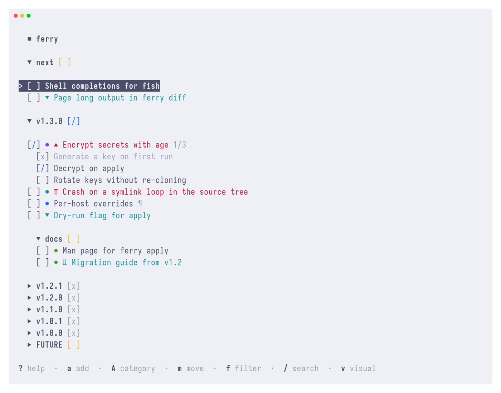
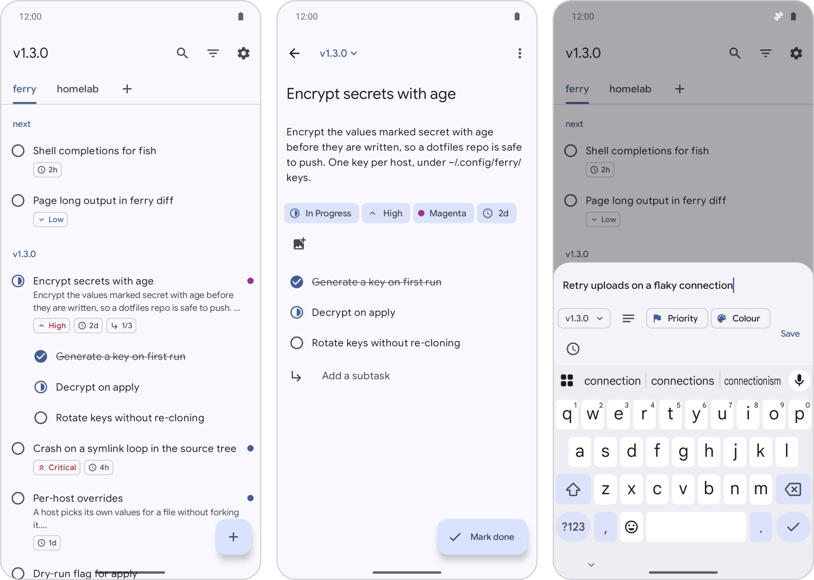

# Ordo

A local-only project planner for the terminal, run entirely from the keyboard. Name a category after a version (`v1.3.0`) and `ctrl+a` or `gm` bumps it in place. It is a single binary that keeps each project in a plain JSON file. The terminal app never touches the network; `ordo serve` adds an opt-in [Android app](#on-the-phone).

<picture>
  <source media="(prefers-color-scheme: dark)" srcset="assets/demo-dark.gif">
  
</picture>

[](https://github.com/ilyasturki/ordo/actions/workflows/ci.yml)
[](https://github.com/ilyasturki/ordo/releases/latest)
[](https://aur.archlinux.org/packages/ordo)
[](LICENSE)

## Install

Ordo runs on Linux and macOS.

### Homebrew

```bash
brew install ilyasturki/ordo/ordo
```

### Arch Linux (AUR)

```bash
yay -S ordo       # build from source
yay -S ordo-bin   # prebuilt binary
```

### Nix

Run without installing:

```bash
nix run github:ilyasturki/ordo
```

Or pin it in your system flake (x86_64-linux, aarch64-linux and aarch64-darwin):

```nix
inputs.ordo.url = "github:ilyasturki/ordo";
# environment.systemPackages = [ inputs.ordo.packages.${pkgs.stdenv.hostPlatform.system}.default ];
```

### Go

```bash
go install github.com/ilyasturki/ordo/cmd/ordo@latest
```

### Prebuilt binary

Grab `ordo-linux-x64`, `ordo-linux-arm64`, `ordo-darwin-x64` or `ordo-darwin-arm64` from the [releases page](https://github.com/ilyasturki/ordo/releases), `chmod +x` it and put it in your `$PATH`. On macOS, a binary downloaded with a browser also needs `xattr -d com.apple.quarantine <file>`.

### From source

```bash
go build -o ordo ./cmd/ordo
```

To try a change, `just run` runs from source on a fresh copy of your data and config in `~/.cache/ordo-run`, so a dev build never writes the real files (`just run-real` runs on them).

## Quick start

```bash
ordo                        # open the project linked to this directory, or the picker
ordo -p ferry               # open a project by name
ordo -p ferry --task <id>   # open with the cursor on a task
ordo pick                   # open the project picker
ordo project link <project> # link this directory to a project
ordo project unlink         # remove this directory's link
```

The first run creates a `Default` project. In the TUI, `a` adds a task, `space` cycles its status, `gi` shows its details, `u` and `ctrl+r` undo and redo, and `?` lists every key and what each mark on a row means. `gc` shows the changelog, and so does `ordo changelog` in a terminal, to pipe into a pager. In the picker (`ctrl+p`), `l` links this directory to the focused project, and on the row marked `(linked)` it unlinks it.

## Features

- `ctrl+a` and `ctrl+x` add or take one from the patch of the version in a category's name (`v1.3.0`, `v1.3.0 - polish`), on one category or a visual range. `gm` and `gM` bump the minor or the major. Only the digits change, so a label or a suffix stays.
- `m` moves the focused task, or a whole visual range, to the end of any other category. `/` filters the list of categories.
- Categories take one level of sub-categories and tasks one level of subtasks. `>` nests a row under the one above it and `<` takes it back out. `gA` adds a sub-category to the category under the cursor, and `J`/`K` carry a sub-category past its parent's edge into the next category.
- `gp` pins a category: pinned ones come first among their siblings, everywhere categories are listed, marked `↑`. A name a sibling already has offers to number this one or the other, as in `Fix (2)`, or to merge them.
- The keys are vim's where vim has one: `j`/`k`, `gg`/`G`, `{`/`}` between categories, `/` then `n`/`N`, `v` for a visual range, `za` to fold or unfold a category and `zc`/`zo` for all of them, `zz` to center. `ze` shows a long row in full.
- Every text field, from a title to the help filter, takes the readline keys: `ctrl+_` (or `ctrl+/`) undoes the last change a word at a time, `ctrl+w`, `alt+d`, `ctrl+k` and `ctrl+u` kill and `ctrl+y` yanks the kill back, in any field, `ctrl+t` and `alt+t` swap characters and words, `alt+u`, `alt+l` and `alt+c` change a word's case, and `alt+<` and `alt+>` go to the start and end. The help filter keeps `ctrl+d` and `ctrl+u` for paging.
- `-` adds a separator below the focused row and `_` adds a note: a line of free text among the tasks, with no status, that moves, cuts, copies and deletes like a separator and hides under a filter. A note copies as `> text`, and a pasted or imported `> ` line comes back as one.
- `p` on several lines of text asks how they should land: one task per line, one task with the rest as its description, every line joined into one title, or appended to the focused task's description. A markdown checklist keeps its `[x]` and `[~]` statuses, its headings become separators and its indented bullets become subtasks. `x` cuts a task, and `p` puts it back elsewhere with the same ID.
- `p` with an image on the clipboard attaches it to the focused task, and so does dropping image files on the terminal; in the description editor, `ctrl+v` and a drop insert it at the cursor. Ordo copies the image into `attachments/` next to the project files, so it syncs with them, and the description references it as ``. The description shows it as `▣ name` and the title row as `▣` (`▣2` for two), descriptions expanded or not. `gx` opens it in the desktop's image viewer, `gi` lists its path, size and pixel size, and `gy` copies its path. An image another machine hasn't synced yet reads `▣ name (not synced yet)`. Text copied out of ordo (`y`, `Y`, a visual `y` or `Y`) and `ordo export -f markdown` point the reference at the file's absolute path instead, so an agent handed the text can open it, and a visual copy lists each task's images under its bullet.
- `h`/`l` step through five priority levels and `t`/`T` set one of four tag dots. `f` filters by status, priority, category or tag; a category the filter hides tasks in ends with an `(N hidden by the filter)` row, and `enter` on it shows them, marked `(filtered out)`. The row stays and reads `(hide the N filtered out)`: `enter` on it, `esc` or leaving the category hides them again. A task an edit takes out of the filter stays, marked `(filtered out)`, until the cursor moves off it. `F` turns the filter off and back on without losing what it holds, and a change in `f` turns it on again. Each project keeps its filter across restarts and on every device.
- Each project is one JSON file, written atomically, which Syncthing can carry between machines. If Syncthing or another program changes the file while it's open, the TUI reloads it within a second, with the cursor on the same row, and says so; a dialog or an input left open waits until it closes. An edit it couldn't save is never written over that change: it marks the project until you reload with `r`, which drops that edit, and asks before quitting would lose it. Conflict copies are Syncthing's to report: Ordo ignores them.
- [Task commands](#task-commands) are opt-in keys that hand the focused task to a program of yours.

## On the phone

Ordo has an Android app, a native one in Kotlin and Jetpack Compose, synced through `ordo serve`. The app keeps a copy of every project, so it opens at once and works without signal: an edit shows right away, waits in a queue, and reaches the project files the next time `ordo serve` answers, even with the app closed. It runs the edits through the TUI's own Go code, and `ordo serve` replays the queue through that code under the same project lock, so an edit sent twice, or landing after another device changed the file, never overwrites anyone. An open app syncs as soon as a project file changes on the server. The APK comes with each [release](https://github.com/ilyasturki/ordo/releases).

It feels like Google Tasks and behaves like the TUI. Projects are tabs over a pager that follows the finger. The top bar names the category taking most of the screen, and one `+` opens a sheet to add tasks to it. Finished tasks stay in place, struck through. Tap a task's circle to step its status, open it to edit its title, description, images, status, priority, tag, estimate and subtasks, and long-press a row to drag it. A category's menu renames it, adds a sub-category, a separator or a note, pins it first, or deletes it, and a long press on a tab or a category header opens the project's categories, to drag them into order or tap one to go to it. Search and Filter sit in the top bar, with the TUI's rules, and every edit offers Undo, apart from a status step short of done. A title or description edit that crosses one made elsewhere shows the file's text and offers Keep mine.

A task's thumbnails open a full-screen viewer, and new images come from the photo picker or the camera, even with no signal: a photo waits on the phone with the edits. Settings → Devices lists the paired devices, signs one out, and shows the code and link that pair a new one.

The TUI doesn't watch the file: once an edit from the app lands, the TUI's next edit is refused and marked, and `r` shows the change, dropping the TUI edits made since.

<picture>
  <source media="(prefers-color-scheme: dark)" srcset="assets/phone-dark.png">
  
</picture>

```bash
ordo serve --base-url https://ordo.example.com   # listens on 127.0.0.1:7319
ordo serve pair                                  # a one-time link and QR code to scan or paste in the app
ordo serve passphrase                            # optional: sign in without a link
ordo serve devices                               # the paired devices; ordo serve revoke <id>
```

The server speaks plain HTTP, so keep it on loopback behind a TLS reverse proxy: the app sends plain HTTP only to `localhost`, `127.0.0.1` and the emulator's host. A paired device stays signed in as long as it's used at least once a year.

To pair the Android app, tap Scan the code on its sign-in screen and point the camera at the code `ordo serve pair` prints, or at the one Devices → Pair a new device shows on a device already signed in, or paste the link; scanning needs Google Play services. The link starts with the address `--base-url` gave the server; `ordo serve pair --base-url` overrides it for one link. A server with a passphrase also offers it on the sign-in screen once you type the server's address. Revoking a device also signs out the devices it paired. Anywhere outside `/api`, the server answers a short plain-text page. On NixOS, the flake's module runs it as a service:

```nix
imports = [ inputs.ordo.nixosModules.default ];
services.ordo-web = { enable = true; user = "alice"; baseUrl = "https://ordo.example.com"; };
```

## CLI

Most of what the TUI does has a command, for scripts and quick edits. Every command takes `-j` for JSON output.

```bash
ordo task add -C next "Retry uploads on a flaky connection"   # capture
ordo tasks -s todo -C v1.3.0                   # what's left, sub-categories included
ordo category add docs --parent v1.3.0         # a sub-category
ordo task add --parent <id> "Decrypt on apply" # a subtask
ordo tasks -C v1.3.0/docs                      # a sub-category by path
ordo task move <id> v1.3.0                     # plan it
ordo task status <id> in_progress              # start it
ordo export -f json -o ferry.json              # snapshot
ordo import ferry.json -n ferry-copy           # load it back as a new project
wl-paste -t image/png | ordo task attach <id> - # attach a screenshot (or a file instead of -)
ordo task show <id>                            # its images, by absolute path
ordo attachments path                          # the directory the images live in
ordo attachments prune                         # images no task references (--yes removes them)
```

Run `ordo --help` for the rest: projects, categories, config and completions.

## Configuration

Config lives at `~/.config/ordo/config.json`. The options screen (`,`) edits the first five keys below, and `ordo config set <key> <value>` sets `status_display` and `copy_via`.

| Key | Values | Default | Description |
|-----|--------|---------|-------------|
| `status_display` | `icons`, `text` | `icons` | The status column as `[x]` glyphs or as words |
| `priority_color` | `full`, `icon`, `none` | `full` | Color the whole title, the priority arrow alone, or nothing |
| `show_shortcut_bar` | `true`, `false` | `true` | The key hints along the bottom of the screen |
| `expand_descriptions_by_default` | `true`, `false` | `false` | Whether descriptions start expanded; `zd` toggles them |
| `show_category_counts` | `true`, `false` | `false` | Done / total after each top-level category name |
| `copy_via` | `osc52`, `wl-copy` | `osc52` | How copies reach the system clipboard: the terminal's OSC 52, or `wl-copy` (`pbcopy` on macOS) |
| `task_commands` | list | none | Keys that run a program on the focused task, below |

`ORDO_CONFIG_PATH` and `ORDO_DATA_PATH` move the config and data directories. `ORDO_CONFIG_PATH` also takes a path ending in `config.json`.

### Task commands

`task_commands` binds keys in the TUI to programs that act on the focused task, such as filing it in another tool. None are set by default.

```json
{
  "task_commands": [
    { "key": "gn", "label": "notify", "prompt": "message", "run": ["notify-send", "--app-name=ordo"] }
  ]
}
```

| Field | Required | Description |
|-------|----------|-------------|
| `key` | yes | One character (`w`), or `g` or `z` followed by one (`gn`). A key a built-in shortcut already uses is refused at launch. |
| `label` | yes | Name shown in `?` and the shortcut bar. |
| `prompt` | no | Asks for one line first; Enter on an empty line cancels. |
| `run` | yes | Program and arguments, run directly, never through a shell. |

The command runs in the background. It gets the task through environment variables: `ORDO_PROJECT_ID`, `ORDO_PROJECT_NAME`, `ORDO_TASK_ID`, `ORDO_TASK_TITLE`, `ORDO_TASK_DESCRIPTION`, `ORDO_TASK_IMAGES` (the absolute paths of its images, one per line), `ORDO_CATEGORY` (its path, `parent / name` for a sub-category, which `-C` resolves), `ORDO_CATEGORY_ID` and `ORDO_INPUT` (the prompt's answer). The first line it prints shows in the status line. A non-zero exit shows as a failure with the first line of its error output.

## Data

```
~/.local/share/ordo/
├── projects/
│   ├── <id>.json          one project per file
│   ├── <id>.view.json     its folds and filter, on every device
│   └── .directories.json  which directory opens which project
├── state.json             this machine's cursors and project open times
└── web.json               devices paired with ordo serve
```

Edits save in the background as you make them, and `u` / `ctrl+r` undo and redo them within a session. Only `projects/` belongs in a sync folder; add `(?d)*.tmp` and `*.lock` to `.stignore` so the write and lock sidecars stay local. [`docs/file-format.md`](docs/file-format.md) documents the format for any other app that reads or writes these files.

## License

[MIT](LICENSE)
