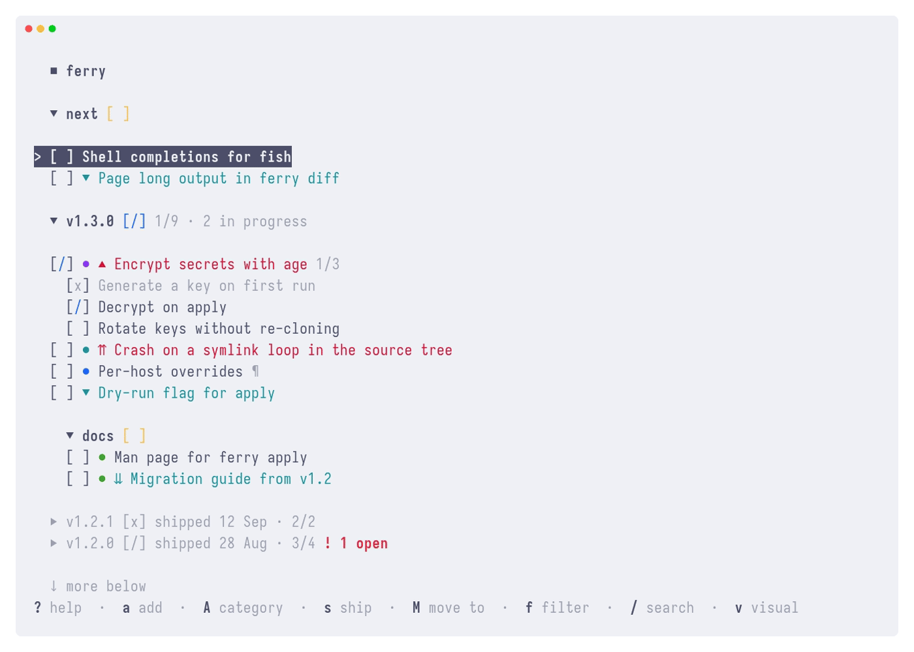

# Ordo

A local-only project planner for the terminal, built around versions. Ideas land in `next` and get planned into `v1.3.0`. It is a single binary that keeps each project in a plain JSON file and never touches the network.

<picture>
  <source media="(prefers-color-scheme: dark)" srcset="assets/demo-dark.gif">
  
</picture>

[](https://github.com/ilyasturki/ordo/actions/workflows/ci.yml)
[](https://github.com/ilyasturki/ordo/releases/latest)
[](https://aur.archlinux.org/packages/ordo)
[](LICENSE)

## Install

Ordo runs on Linux and macOS.

### Homebrew

```bash
brew install ilyasturki/ordo/ordo
```

### Arch Linux (AUR)

```bash
yay -S ordo       # build from source
yay -S ordo-bin   # prebuilt binary
```

### Nix

Run without installing:

```bash
nix run github:ilyasturki/ordo
```

Or pin it in your system flake (x86_64-linux, aarch64-linux and aarch64-darwin):

```nix
inputs.ordo.url = "github:ilyasturki/ordo";
# environment.systemPackages = [ inputs.ordo.packages.${pkgs.stdenv.hostPlatform.system}.default ];
```

### Go

```bash
go install github.com/ilyasturki/ordo/cmd/ordo@latest
```

### Prebuilt binary

Grab `ordo-linux-x64`, `ordo-linux-arm64`, `ordo-darwin-x64` or `ordo-darwin-arm64` from the [releases page](https://github.com/ilyasturki/ordo/releases), `chmod +x` it and put it in your `$PATH`. On macOS, a binary downloaded with a browser also needs `xattr -d com.apple.quarantine <file>`.

### From source

```bash
go build -o ordo ./cmd/ordo
```

## Quick start

```bash
ordo                        # open the project linked to this directory, or the picker
ordo -p ferry               # open a project by name
ordo -p ferry --task <id>   # open with the cursor on a task
ordo pick                   # open the project picker
ordo project link           # link this directory to a project
```

The first run creates a `Default` project. In the TUI, `a` adds a task, `space` cycles its status, `gi` shows its details, `u` and `ctrl+r` undo and redo, and `?` lists every key.

## Features

- A top-level category named `vX.Y.Z` is a version, and a label may follow the number (`v1.3.0 - polish`).
- A category called `next` is the inbox for whatever hasn't been planned. `M` sends the focused task, or a whole visual range, to an open version or back to the inbox.
- Categories take one level of sub-categories and tasks one level of subtasks. `>` nests a row under the one above it and `<` takes it back out.
- The keys are vim's where vim has one: `j`/`k`, `gg`/`G`, `{`/`}` between categories, `/` then `n`/`N`, `v` for a visual range, `za` to fold or unfold a category and `zc`/`zo` for all of them, `zz` to center. `ze` shows a long row in full.
- `p` on several lines of text asks how they should land: one task per line, one task with the rest as its description, every line joined into one title, or appended to the focused task's description. A markdown checklist keeps its `[x]` and `[~]` statuses, its headings become separators and its indented bullets become subtasks. `x` cuts a task, and `p` puts it back elsewhere with the same ID.
- `h`/`l` step through five priority levels and `t`/`T` set one of eight tag marks. `f` filters by status, priority, category or tag.
- Each project is one JSON file, written atomically, which Syncthing can carry between machines. If Syncthing or another program changes the file while it's open, the TUI won't overwrite it and asks you to reload; it also names any conflict copy it finds.
- [Task commands](#task-commands) are opt-in keys that hand the focused task to a program of yours.

## CLI

Most of what the TUI does has a command, for scripts and quick edits. Every command takes `-j` for JSON output.

```bash
ordo task add -C next "Retry uploads on a flaky connection"   # capture
ordo tasks -s todo -C v1.3.0                   # what's left, sub-categories included
ordo category add docs --parent v1.3.0         # a sub-category
ordo task add --parent <id> "Decrypt on apply" # a subtask
ordo tasks -C v1.3.0/docs                      # a sub-category by path
ordo task move <id> v1.3.0                     # plan it
ordo task status <id> in_progress              # start it
ordo export -f json -o ferry.json              # snapshot
ordo import ferry.json -n ferry-copy           # load it back as a new project
```

Run `ordo --help` for the rest: projects, categories, config and completions.

## Configuration

Config lives at `~/.config/ordo/config.json`. The options screen (`,`) edits the first five keys below, and `ordo config set <key> <value>` sets `status_display` and `copy_via`.

| Key | Values | Default | Description |
|-----|--------|---------|-------------|
| `status_display` | `icons`, `text` | `icons` | The status column as `[x]` glyphs or as words |
| `priority_color` | `full`, `icon`, `none` | `full` | Color the whole title, the priority arrow alone, or nothing |
| `show_shortcut_bar` | `true`, `false` | `true` | The key hints along the bottom of the screen |
| `expand_descriptions_by_default` | `true`, `false` | `false` | Whether descriptions start expanded; `zd` toggles them |
| `show_category_counts` | `true`, `false` | `false` | Done / total after each top-level category name |
| `copy_via` | `osc52`, `wl-copy` | `osc52` | How copies reach the system clipboard: the terminal's OSC 52, or `wl-copy` (`pbcopy` on macOS) |
| `task_commands` | list | none | Keys that run a program on the focused task, below |

`ORDO_CONFIG_PATH` and `ORDO_DATA_PATH` move the config and data directories. `ORDO_CONFIG_PATH` also takes a path ending in `config.json`.

### Task commands

`task_commands` binds keys in the TUI to programs that act on the focused task, such as filing it in another tool. None are set by default.

```json
{
  "task_commands": [
    { "key": "gn", "label": "notify", "prompt": "message", "run": ["notify-send", "--app-name=ordo"] }
  ]
}
```

| Field | Required | Description |
|-------|----------|-------------|
| `key` | yes | One character (`m`), or `g` or `z` followed by one (`gn`). A key a built-in shortcut already uses is refused at launch. |
| `label` | yes | Name shown in `?` and the shortcut bar. |
| `prompt` | no | Asks for one line first; Enter on an empty line cancels. |
| `run` | yes | Program and arguments, run directly, never through a shell. |

The command runs in the background. It gets the task through environment variables: `ORDO_PROJECT_ID`, `ORDO_PROJECT_NAME`, `ORDO_TASK_ID`, `ORDO_TASK_TITLE`, `ORDO_TASK_DESCRIPTION`, `ORDO_CATEGORY` (its path, `parent / name` for a sub-category, which `-C` resolves), `ORDO_CATEGORY_ID` and `ORDO_INPUT` (the prompt's answer). The first line it prints shows in the status line. A non-zero exit shows as a failure with the first line of its error output.

## Data

```
~/.local/share/ordo/
├── projects/
│   └── <id>.json    one project per file
└── state.json       this machine's folds, cursors, project order and directory links
```

Edits save in the background as you make them, and `u` / `ctrl+r` undo and redo them within a session. Only `projects/` belongs in a sync folder; add `(?d)*.tmp` and `*.lock` to `.stignore` so the write and lock sidecars stay local. [`docs/file-format.md`](docs/file-format.md) documents the format for any other app that reads or writes these files.

## License

[MIT](LICENSE)
